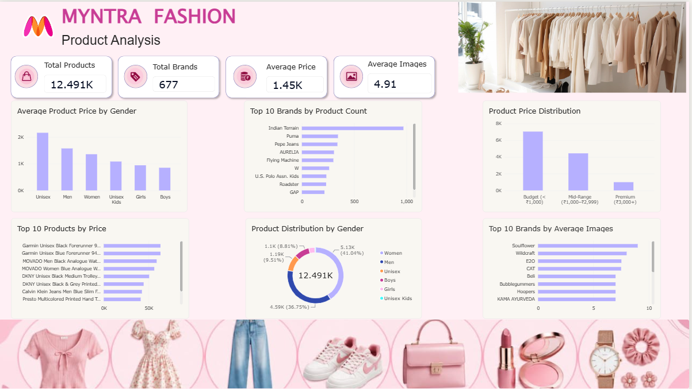

# Myntra Fashion Product Analysis

## Project Overview
This project explores Myntra fashion product catalog data using Power BI. The dashboard provides insights into product pricing, brand distribution, gender-wise product availability, price patterns, and catalog characteristics through interactive visualizations.

## Objectives
- Analyze the distribution of products across genders.
- Identify brands with the highest number of listed products.
- Explore product price distribution and compare average prices by gender.
- Identify the highest-priced products in the catalog.
- Examine brand-wise product image counts.

## Dataset
- **Dataset:** Myntra Fashion Product Catalog
- **Total Products:** 12,491
- **Distinct Brands:** 677
- **Source:** [Myntra Fashion Product Analysis Dataset on GitHub](https://github.com/anmolmalviya05/Myntra-Fashion-Product-Analysis)

The dataset includes product IDs, product names, brands, gender categories, prices, image counts, descriptions, and primary colors.

## Tools Used
- **Power BI Desktop** — Dashboard development and visualization
- **Power Query** — Data preparation, if used in the project

## Analysis Performed
- **Product Overview:** Total product count and distinct brand count.
- **Pricing Analysis:** Average product price by gender and overall price distribution.
- **Brand Analysis:** Top 10 brands by product count.
- **Product Price Comparison:** Top 10 highest-priced products.
- **Gender Distribution:** Product distribution across gender categories.
- **Catalog Characteristics:** Top 10 brands by average number of product images.

## Dashboard Highlights
The dashboard includes KPI cards and visualizations to explore product catalog composition, brand representation, and pricing patterns.

## Key Findings
The dashboard summarizes product and brand counts, average pricing, gender distribution, and differences in product catalog characteristics.

*Specific business findings should be added after verifying the values displayed in the dashboard.*

## Project Files
- `Myntra_Fashion_Product_Analysis.pbix` — Power BI dashboard file.

## Conclusion
This project demonstrates how Power BI can be used to explore fashion e-commerce catalog data and communicate product, brand, and pricing patterns through visual analytics.

**Note:** This project analyzes product catalog data. It does not measure actual sales, revenue, profit, customer purchases, or inventory performance.

## Dashboard Preview

### Welcome Page

### Fashion Analysis Dashboard

